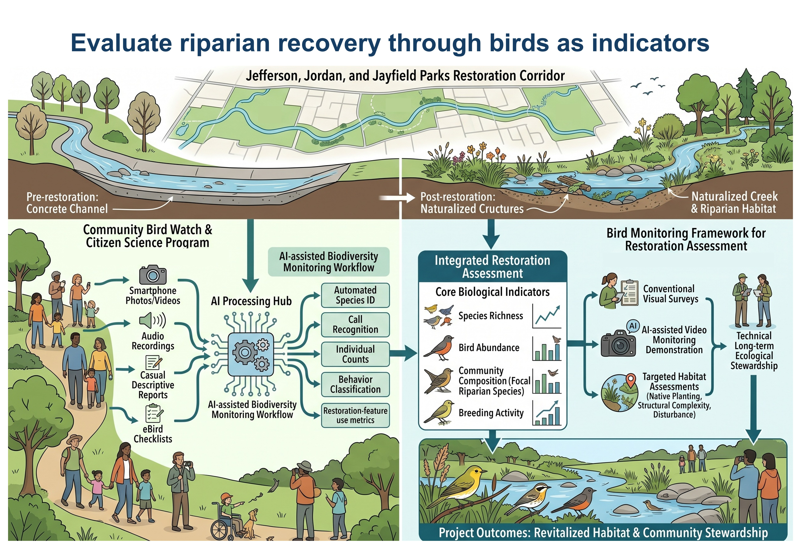
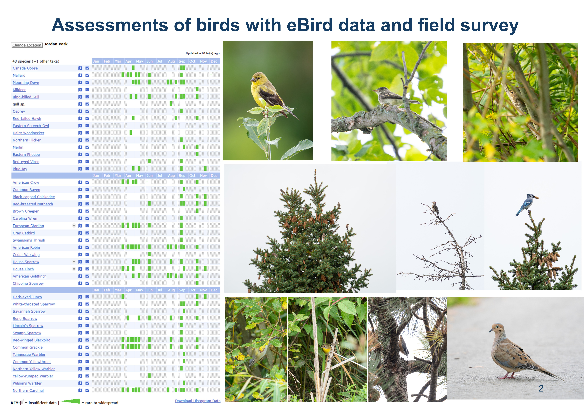
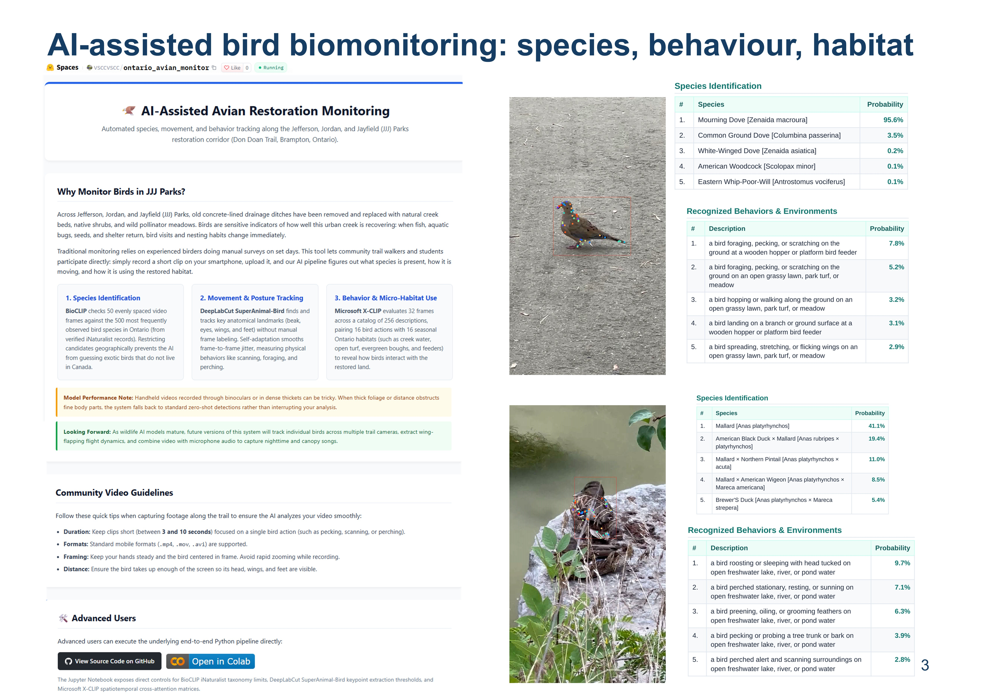
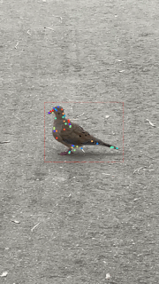

# Integrated Avian Biomonitoring and Ecological Restoration Assessment for the JJJ Parks Corridor
[Integrated Avian Biomonitoring and Ecological Restoration Assessment for the JJJ Parks Corridor](https://jefferson-jordan-jayfield-park.netlify.app/)

  

## Ecological Restoration Context and Monitoring Framework
Urban stream naturalisation across Jefferson, Jordan, and Jayfield (JJJ) Parks along the Don Doan Trail in Brampton addresses channel degradation caused by concrete-lined drainage infrastructure. Avian community composition, relative abundance, and behaviour mirror shifts in vegetation density, channel geomorphology, macroinvertebrate prey, and water quality, making birds practical bio-indicators of ecosystem recovery. To evaluate post-construction outcomes, the Bird Monitoring Framework defines four biological indicators: species richness, overall abundance, community composition focusing on riparian specialists, and confirmed breeding evidence. These biological metrics are assessed alongside physical habitat conditions, including native planting establishment, structural complexity, habitat heterogeneity, and urban wildlife connectivity. Rather than relying exclusively on periodic transects by specialised observers, the framework establishes a multi-tiered approach. This structure integrates visual surveys, historical citizen-science records, community observations, and automated video workflows to determine whether the corridor supports a functional riparian bird community.

## Pre-Restoration Field Reconnaissance and eBird Baseline Benchmark

  

Restoration evaluation requires empirical baseline data drawn from citizen-science inventories and targeted field surveys. An eBird baseline assessment compiling 47 checklists submitted between May 2025 and September 2026 across three dedicated park hotspots showed marked ecological variation among parcels. Jefferson Park recorded 31 species across 15 checklists, Jordan Park documented 43 species across 23 checklists, and Jayfield Park logged 32 species across 9 checklists. Jordan Park supported upper-trophic species including Osprey, Merlin, and Eastern Screech-Owl alongside forest birds such as Brown Creeper. In contrast, Jayfield Park recorded grassland Species at Risk, including Bobolink, alongside migratory songbirds like Veery. Complementing these historical records, a 1.31-kilometre roving field survey conducted on 13 September 2026 logged 22 species and 213 detections across three consecutive eBird Mobile checklists. The survey confirmed that active channel reconstruction had not begun: the channel bed contained shallow, stagnant grey water lacking riffles or pools, riparian vegetation remained unstratified and overgrown, and birds experienced regular disturbance from cyclists and off-leash dogs.

## Community Stewardship and Low-Barrier Citizen Science
The Community Bird Watch Programme engages local park visitors in post-restoration monitoring to supplement professional field coverage across space and time. The programme reduces entry barriers by welcoming trail walkers, families, students, and community groups without requiring prior identification skills, binoculars, or specialised software experience. Participants contribute observations by uploading smartphone photographs, short video clips, audio recordings of calls, or simple descriptive wildlife sightings to a community portal, with optional eBird submission. Combined with seasonal guided nature walks, photography sessions, and trailside guidelines (such as remaining on paved paths and protecting newly planted bank vegetation), the initiative generates community-sourced monitoring data while supporting local environmental stewardship along the urban creek.

## Multi-Modal Artificial Intelligence Video Processing Pipeline
[Multi-Modal Artificial Intelligence Video Processing Pipeline](https://huggingface.co/spaces/vsccvscc/ontario_avian_monitor)

  

The technical component of this framework uses an automated computer vision pipeline to extract biological records from uncurated field video collected by park visitors. The workflow integrates three foundation models across distinct analytical steps. First, taxonomic identification uses zero-shot BioCLIP evaluated across 50 uniform temporal keyframes. To prevent the model from predicting non-native taxa, candidate classes are restricted to the 500 most recorded Ontario bird species on iNaturalist (Place ID: 6883). Second, kinematic pose estimation is conducted with DeepLabCut 3.0's SuperAnimal-Bird model, combining a Faster R-CNN MobileNet-v3 detector and a ResNet-50 keypoint estimator to track anatomical landmarks (including beak, eyes, wings, and feet) with temporal video adaptation applied to reduce frame-to-frame jitter. Third, ethological actions and micro-habitat context are classified using Microsoft X-CLIP video-language matching across 32 sampled frames evaluated against a 256-query matrix (16 avian behaviours paired with 16 seasonal Ontario habitat substrates). Across preliminary field recordings, the pipeline classified unobstructed subjects, including Mallard (41.1%), American Goldfinch (75.6%), and Mourning Dove (95.6%), and resolved discrete behaviours such as waterfowl roosting on open water (9.7%) and Blue Jays perching alertly in conifers (37.8%).

## Technical Limitations, Future Roadmap, and Ecological Vision

  

Field trials confirmed that the current pipeline functions as an early demonstration rather than an operational biomonitoring platform. Distant subjects, motion blur, and dense foliage obstructed keypoint detection, causing the pose model to default to bounding-box detections rather than generating unreliable landmark coordinates. Subsequent iterations will investigate multi-camera tracking, continuous acoustic monitoring, parametric 3D mesh recovery, and temporal action segmentation to quantify behavioural time budgets across extended sequences. For habitat restoration, baseline observations identify clear physical priorities: establishing continuous riffle-pool flow, providing soft-sediment mud margins, planting layered native dogwood and willow thickets, and restoring tall-grass meadow buffers. Planting dense, thorny shrub perimeters (such as native hawthorn or wild rose) along trail margins will reduce recreational disturbance in sensitive bank zones, supporting foraging and stopover habitat for target species such as American Woodcock, Connecticut Warbler, and Short-eared Owl as restored vegetation matures.

## References
* **An, L., Lyu, J., Lin, L., Cheng, P., Liu, Y., & Tang, X.** (2026). AniMer+: Unified Pose and Shape Estimation Across Mammalia and Aves via Family-Aware Transformer. *IEEE Transactions on Pattern Analysis and Machine Intelligence*, 48(3), 3233–3249. https://doi.org/10.1109/TPAMI.2025.3633828
* **Bane, K., Pandey, K. B., Dalal, P., Sen, A., Patil, N., & Gupta, S.** (2025). Avian Census: Real-Time Bird Counting Using Region-Based Convolutional Neural Network. In S. Manoharan, A. Tugui, & I. Perikos (Eds.), *Proceedings of 5th International Conference on Artificial Intelligence and Smart Energy*. Springer Nature Switzerland. https://doi.org/10.1007/978-3-031-90478-3_6
* **Bernardes, M. M., Braz, V. da S., & França, F. G. R.** (2026). Restoration effects on avian populations and communities: an integrative review. *Biota Neotropica*, 26, e20251865.
* **Chaniago, R. A. F., & Huang, Y.-P.** (2026). Bird Behavior Prediction Using YOLO-Pose Keypoint Detection and Spatial-Temporal Graph Modeling. *2026 IEEE 30th International Conference on Intelligent Engineering Systems (INES)*, 433–438. https://doi.org/10.1109/INES69513.2026.11661213
* **Crego, R. D., et al.** (2026). Linking eBird data with high spatiotemporal remote sensing products to estimate occupancy of bird populations across the island of Ireland. *Ibis*, 168, 1464–1482.
* **Dinya, G., Gelencsér-Horváth, A., Ferretti, A., Rattenborg, N., & Lőrincz, A.** (2025). Multi-Camera Synchronization and Instance Tracking for Avian Behavior Analysis in a Floating Aviary. *Ecological Informatics*, 92, 103419. https://doi.org/10.1016/j.ecoinf.2025.103419
* **Lange, B.** (2025). Bird Identification Using AI for Wind Turbine Farms. *2025 5th International Conference on Electrical, Computer and Energy Technologies (ICECET)*, 1–6. https://doi.org/10.1109/ICECET63943.2025.11472199
* **Lee, D.-H., et al.** (2026). From scale to structure: drivers of winter bird diversity and community composition in urban riparian ecosystems. *Urban Ecosystems*, 29, 261.
* **Liao, C., Jiang, Y., Yang, M., Feng, K., & Zhang, J.** (2025). Investigating the Impact of Urban Parks on Bird Habitats and Diversity Through Remote Sensing: A Case Study of Chengdu City (China). *Land*, 14, 2086.
* **Ni, B., Peng, H., Chen, M., Zhang, S., Meng, G., Fu, J., Xiang, S., & Ling, H.** (2022). Expanding Language-Image Pretrained Models for General Video Recognition. In S. Avidan, G. Brostow, M. Cissé, G. M. Farinella, & T. Hassner (Eds.), *Computer Vision – ECCV 2022* (pp. 1–18). Springer Nature Switzerland. https://doi.org/10.1007/978-3-031-19772-7_1
* **Ooko, S. O., Ndashimye, E., Twahirwa, E., & Busogi, M.** (2025). IoT and Machine Learning for Smart Bird Monitoring and Repellence: Techniques, Challenges, and Opportunities. *IoT*, 6, 46.
* **Ostojic, M., & Sethi, S. S.** (2026). Automated Bird Flight Pattern Extraction and Classification Using Machine Learning. *Ecological Informatics*, 97, 103946. https://doi.org/10.1016/j.ecoinf.2026.103946
* **Rousseau, J. S., Johnston, A., & Rodewald, A. D.** (2025). Where the wild bees are: Birds improve indicators of bee richness. *PLOS ONE*, 20, e0321496.
* **Sancho-Deltell, B., Rodriguez-Juan, J., Benavent-Lledo, M., Mulero-Perez, D., Ortiz-Perez, D., & Garcia-Rodriguez, J.** (2026). Exploring Temporal Action Segmentation Techniques for Enhanced Bird Behavior Recognition. In E. Corchado, H. Quintián, & A. Troncoso Lora (Eds.), *Soft Computing Models in Industrial and Environmental Applications*. Springer Nature Switzerland. https://doi.org/10.1007/978-3-032-19763-4_49
* **Stevens, S., Wu, J., Thompson, M. J., Campolongo, E. G., Song, C. H., Carlyn, D. E., Dong, L., Dahdul, W. M., Stewart, C., Berger-Wolf, T., Chao, W.-L., & Su, Y.** (2024). BioCLIP: A Vision Foundation Model for the Tree of Life. *2024 IEEE/CVF Conference on Computer Vision and Pattern Recognition (CVPR)*, 19412–19424. https://doi.org/10.1109/CVPR52733.2024.01836
* **Trappes, R.** (2026). Global Citizen Science as a Source of Epistemic Diversity: The Case of eBird India. *Social Epistemology*, 40, 536–556.
* **Uiterwaal, S. F., et al.** (2026). Urban habitat restoration increases native bird diversity in the Midwestern United States. *Ecological Applications*, 36, e70207.
* **Viswanathan, A., et al.** (2025). State of India’s Birds 2023: A framework to leverage semi-structured citizen science for bird conservation. *Ecosphere*, 16, e70290.
* **Wei, J., et al.** (2025). Identifying Priority Bird Habitats Through Seasonal Dynamics: An Integrated Habitat Suitability–Risk–Quality Framework. *Sustainability*, 17, 6078.
* **Wen, C., et al.** (2026). Integrating human perceptions into ecological restoration: Analyzing the mismatches and barriers between ecological components, ecosystem services, and human perceptions in riparian green spaces. *Ecological Engineering*, 232, 108121.
* **Ye, S., Filippova, A., Lauer, J., Schneider, S., Vidal, M., Qiu, T., Mathis, A., & Mathis, M. W.** (2024). SuperAnimal pretrained pose estimation models for behavioral analysis. *Nature Communications*, 15(1), 5165. https://doi.org/10.1038/s41467-024-48792-2
* **Zhao, X., Shen, C., Xie, J., & Li, J.** (2027). Beyond Accuracy: AI-Based Bird Behavior Automated Recognition toward Ecological Understanding. *Avian Research*, 18(1), 100435. https://doi.org/10.1016/j.avrs.2026.100435
